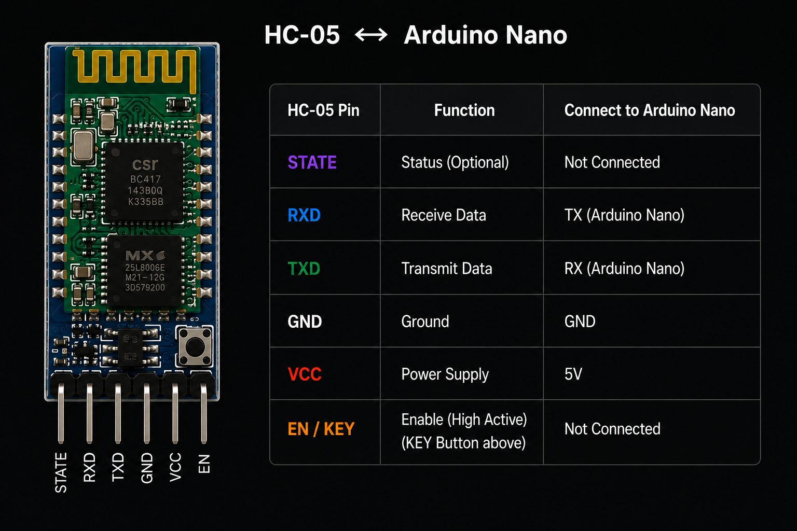

## HC-05 Master–Slave Configuration

Two HC-05 modules are used to establish the wireless link between the **controller** and the **RC car**.

```text
Hand Controller
Arduino Nano
     │
     ▼
HC-05 Master
     )))))) Bluetooth ((((((
HC-05 Slave
     │
     ▼
Arduino Nano
RC Car
```

- **Master:** Connected to the controller Nano
- **Slave:** Connected to the car Nano
- **Communication:** `SoftwareSerial`
- **Normal baud rate:** `9600`

### Enter AT Mode

To configure an HC-05:

1. Disconnect power from the module.
2. Press and hold the **KEY/EN** button.
3. Power the module while keeping the button pressed.
4. Hold it for a few seconds until the LED changes to the slower AT-mode blink.
5. Release the button.

Use an Arduino Nano as a serial bridge:

```cpp
#include <SoftwareSerial.h>

SoftwareSerial BT(10, 11);  // RX, TX

void setup()
{
    Serial.begin(9600);
    BT.begin(38400);
}

void loop()
{
    if (Serial.available())
        BT.write(Serial.read());

    if (BT.available())
        Serial.write(BT.read());
}
```

Test with:

```text
AT
```

Expected response:

```text
OK
```

> `38400` is commonly used for AT mode. This may vary depending on the HC-05 firmware.

### Slave Configuration

HC-05 connected to the **RC car Nano**:

```text
AT+ROLE=0
AT+NAME=HC05_SLAVE
AT+UART=9600,0,0
AT+ADDR?
```

Save the address returned by `AT+ADDR?`.

### Master Configuration

HC-05 connected to the **hand-controller Nano**:

```text
AT+ROLE=1
AT+NAME=HC05_MASTER
AT+UART=9600,0,0
AT+BIND=<SLAVE_ADDRESS>
AT+CMODE=0
```

Replace `<SLAVE_ADDRESS>` with the address obtained from the Slave.

### Final Configuration

```text
Controller Nano → HC-05 Master
Car Nano        → HC-05 Slave

Master → ROLE  = 1
Master → BIND  = Slave address
Master → CMODE = 0

Slave  → ROLE  = 0

Both   → UART  = 9600
```

After configuration, power-cycle both modules **without holding KEY/EN**.

The Master will automatically attempt to connect to the configured Slave.

### Normal Communication

In normal operation:

```cpp
#include <SoftwareSerial.h>

SoftwareSerial BT(RX_PIN, TX_PIN);

void setup()
{
    BT.begin(9600);
}
```

The controller Nano sends the **movement commands generated from hand orientation** through the Master HC-05. The car Nano receives them through the Slave HC-05.

### Wiring

> **Note:** When using a 5 V Arduino Nano, use a voltage divider on the **Arduino TX → HC-05 RX** line.


<h3 align="center">Wiring</h3>

<p align="center">
  
</p>